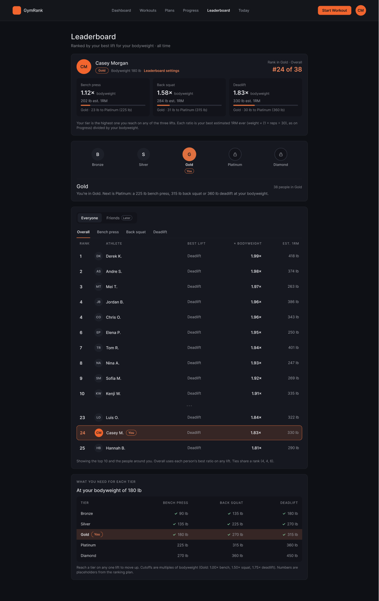
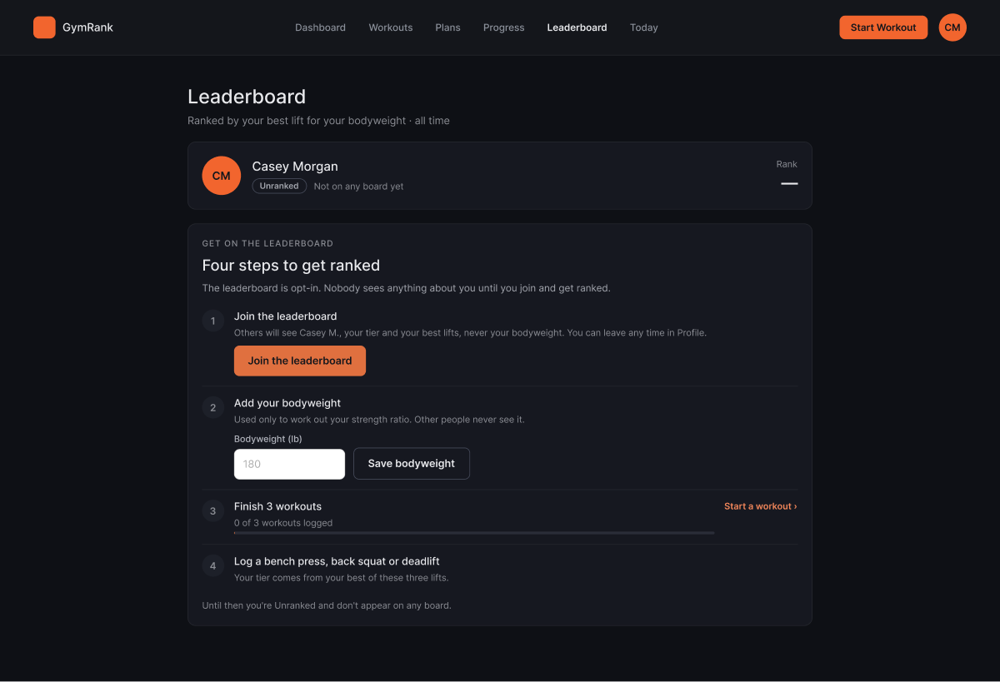
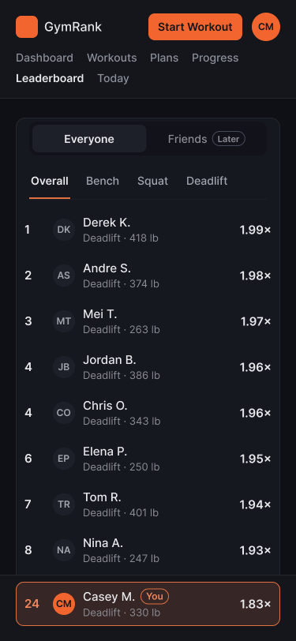
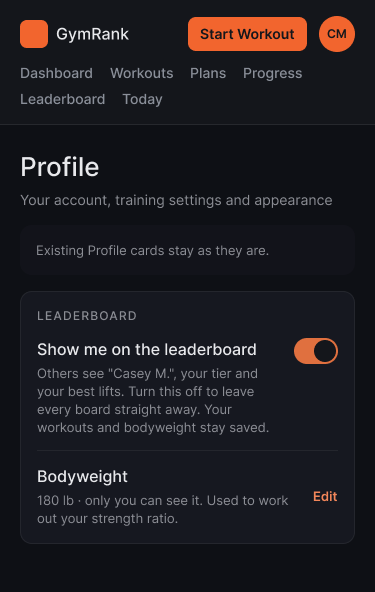

# Story #10 leaderboard: research

- **Story:** #10, "As a competitive gym goer, I want to view my rank and compare my performance against others…"
- **Status:** planning only, for PM review before implementation starts. Nothing here is built.
- **Who writes what:** one file for both research tasks under story #10.
  - Sam (research task #113, branch `113-leaderboard-participation-research`) writes "Participation and viewing the
    rankings".
  - Mansur writes "Ranking rules and data" on his own branch, after #113 is merged into dev.
  - Both write the "Coordinated recommendation" together.
- **Sketches:** [Figma page "Leaderboard plan (story #10)"](https://www.figma.com/design/JMSaaXvmkMfjxrQuQqQ7CV/GymRank?node-id=1917-55)

## Participation and viewing the rankings (Sam, #113)

This part covers who takes part, how people view the rankings and how they find their own position. The numbers follow
Mansur's proposed ranking plan: the score is your best estimated 1RM ÷ your bodyweight; your tier is the highest one you
reach on bench press, back squat or deadlift; and the tier cutoffs are placeholders. If his worked examples change, the
numbers here change with them.

### Who takes part

| | A. Opt-in public tier boards (recommended) | B. Friends only |
| --- | --- | --- |
| Who appears | People who pressed **Join the leaderboard**, added a bodyweight and finished 3 workouts. You only appear on your own tier's boards. | You plus people who accepted your invite, across all tiers. |
| How you join and leave | A Join button on the Leaderboard page. You leave with a **Show me on the leaderboard** switch on Profile. | Invite people by link and they accept. You leave by removing a friend. |
| Ineligible state | A "Four steps to get ranked" checklist (frames D4/P4, D5/P5). | The same checklist, plus "1 friend isn't ranked yet" under the list. |
| Empty state | A tier with nobody in it (D6/P6), or a new site where nobody is ranked yet. | The normal state for every new account: "Compare with friends" and **Copy invite link** (D10/P10). |
| Finding yourself | Needed: the top 10, a `· · ·` gap, then you with one person above and below. Your row is pinned to the bottom of a phone screen while you scroll. | Easy: the list is short. |
| Test accounts | They never press Join, and the backend hides them as well. The seeded demo people stay visible for acceptance tests. | They never appear unless someone invites them. |
| New data | A joined flag, bodyweight, and a test-account flag. | Friendships and invites (the same system story #78 needs). |
| Size of the work | 1 backend task and 1 frontend task, plus a Profile card. | About 2 backend and 2 frontend tasks, overlapping story #78. |
| What similar apps do | Tonal ("Join the leaderboard" and a privacy toggle), adidas Running ("Join running leaderboard" toggle). | Hevy (one board per exercise, Following only), Strava (Overall and Following tabs). |

**Recommendation:** build option A now. That means opt-in tier boards over all time, with an explicit Join and a way to
leave from Profile. Keep Friends as a disabled choice next to Everyone, and build option B later with story #78's invite
system. The reasons:

- Option A is what story #10 describes: your position and everyone's scores.
- The fitness apps we looked at all make joining an explicit choice that you can undo.
- Option B on its own leaves every new account with an empty board.
- It reuses the rest of the page, so Friends can be added later without a redesign.

### How someone becomes eligible, views the rankings and finds their position

1. **Leaderboard** in the top navigation opens the page. Until you qualify you're "Unranked": your rank shows "—" and
   there are no tables. A "Four steps to get ranked" card lists, in order:
   1. **Join the leaderboard.** It says others will see "Casey M.", your tier and your best lifts, never your
      bodyweight.
   2. **Add your bodyweight.** It's private and used only for the ratio.
   3. **Finish 3 workouts** ("0 of 3 workouts logged").
   4. **Log a bench press, back squat or deadlift.**

   Frames D4/P4 show this card. Frames D5/P5 show "One more workout to get ranked".
2. Once you're ranked, the page opens on your own tier, Everyone, Overall (D1/P1). A ladder of five tier badges (Bronze
   to Diamond) shows your tier filled and marked "You", and the tiers above it locked. Under it are the tier's name, its
   people count, and a one-line rule ("Next is Platinum: a 225 lb bench press, 315 lb back squat or 360 lb deadlift at
   your bodyweight").
3. You view other rankings with three controls: the tier badges, an **Everyone | Friends** switch (Friends is marked
   "Later"), and the tabs **Overall**, **Bench press**, **Back squat** and **Deadlift**. Rows show the rank, first name
   and last initial, the lift, the ratio to bodyweight and the estimated 1RM in lb. Ties share a rank (4, 4, 6). Opening
   a tier you're not in shows "You're in Gold, so you're not on this board" (D3/P3).
4. You find your position in three places:
   - The "Your standing" card shows your tier, your rank on the current board ("#24 of 38") and your three lifts, each
     with its ratio, its lb and how many lb you need for the next tier.
   - In the table, your row is highlighted and marked "You". The board shows the top 10, `· · ·`, then you ±1 (D1, D2).
   - On a phone, your row stays pinned to the bottom of the screen while the top 10 is in view (P1b).
5. A "What you need for each tier" table turns the cutoffs into lb at your bodyweight, with ticks on the tiers you've
   reached.
6. You leave from Profile: a new "Leaderboard" card has a **Show me on the leaderboard** switch and your bodyweight
   (D11/P11). **Leaderboard settings** on your card links there.

| Ranked, desktop (D1) | Unranked, desktop (D4) |
| --- | --- |
|  |  |

| Your row pinned on a phone (P1b) | Leaving from Profile on a phone (P11) |
| --- | --- |
|  |  |

### Sketches

All frames are on the Figma page linked above, at 1440 wide (desktop) and 375 wide (phone). Every frame also has a
light-mode copy ("— light"), and every colour comes from the app's `--gr-` colour tokens in `src/index.css`.

- D1/P1: ranked, Gold, Overall, with you outside the top 10 and a tie at 4
- P1b: phone scrolled to the top 10, with your row pinned to the bottom
- D2/P2: ranked, Gold, Bench press board (Mansur's example: #14, 1.12×, 225 lb to Platinum)
- D3/P3: viewing another tier (Platinum), where you're not on the board
- D4/P4: unranked: not joined, no bodyweight, 0 of 3 workouts
- D5/P5: unranked: joined, bodyweight saved, 2 of 3 workouts
- D6/P6: empty tier (Diamond)
- D7/P7: loading
- D8/P8: couldn't load, with Try again
- D9/P9: option B (later phase): Friends board, for comparison
- D10/P10: option B (later phase): Friends with nobody yet
- D11/P11: Profile card with "Show me on the leaderboard" and bodyweight

### Proposed acceptance tests

These are proposals for the PM to review, not story #10's card yet. Once they're approved, they move into
`stories/10-leaderboard.md` and onto the card. They use proposed seed accounts, which the backend task would load. None
of them is an existing seed user, so stories 8, 9 and 18 keep their numbers. Boards show people as first name + last
initial.

- `Casey Morgan`, email `casey.morgan@example.com`: has joined, bodyweight 180 lb, more than 3 finished workouts. Best
  estimated 1RMs: bench press 202 lb, back squat 284 lb, deadlift 330 lb. Gold on all three lifts, #24 of 38 on Gold's
  Overall board and #14 on its Bench press board.
- 37 other Gold members (Derek K., Andre S. … Hannah B., as in the sketches), 7 Platinum members and nobody in Diamond.
  Jordan B. and Chris O. tie at 1.96× on Overall.
- `Luis Ortega`, email `luis.ortega@example.com`: a Gold member (#23, Deadlift 1.84×), used to look at the board as
  someone else.
- `Robin Hale`, email `robin.hale@example.com`: has joined, bodyweight saved, a bench press logged, 2 finished workouts.
- `Max Tester`, email `max.tester@example.com`: marked as a test account. Has joined, bodyweight 180 lb, 10 finished
  workouts, a 600 lb deadlift.

#### Acceptance Test 1: A new account is Unranked and sees how to get on the leaderboard

**Setup:** Connect to the UB VPN or use the campus network. Open the
[Login page](https://cattle.cse.buffalo.edu/CSE442/2026-Fall/cse-442y/#/login). Create a new account (for example
`Lead Tester`, `lead-a-1022@example.com`, `AcceptLead12!`), log in, and finish setup until the Dashboard opens.

1. Select **Leaderboard** in the top navigation. Confirm that the address ends in `#/leaderboard`, that **Leaderboard**
   is highlighted, and that the heading says `Leaderboard`.
2. Confirm that your card shows your name, the label `Unranked` and Rank `—`.
3. Confirm that a card titled `Four steps to get ranked` lists, in this order: `Join the leaderboard` (with a
   **Join the leaderboard** button), `Add your bodyweight`, `Finish 3 workouts` with `0 of 3 workouts logged`, and
   `Log a bench press, back squat or deadlift`.
4. Confirm that the page shows no tier badges, no Everyone/Friends switch, no lift tabs and no table of people.

#### Acceptance Test 2: Joining and saving your bodyweight complete the first two steps, and your bodyweight stays private

**Setup:** Log in as the account from Acceptance Test 1 and select **Leaderboard**.

1. Confirm that step 1 says what others will see: your first name and last initial, your tier and your best lifts, and
   never your bodyweight. Select **Join the leaderboard**. Confirm that step 1 now has a tick.
2. Type `0` in **Bodyweight (lb)** and select **Save bodyweight**. Confirm that a message next to the field says what's
   wrong and how to fix it (for example `Enter your bodyweight in pounds, from 50 to 700.`), and that step 2 isn't ticked.
3. Type `180` and select **Save bodyweight**. Confirm that step 2 now has a tick and says `180 lb`.
4. Log out, log back in and select **Leaderboard**. Confirm that steps 1 and 2 are still ticked and step 2 still says
   `180 lb`.
5. Log in as `casey.morgan@example.com` and select **Leaderboard**. Confirm that no row on any board shows anyone's
   bodyweight, only names, ratios and estimated 1RMs.

#### Acceptance Test 3: A ranked person sees their tier, their three lifts and their own place on the board

**Setup:** Log in as `casey.morgan@example.com` and select **Leaderboard**.

1. Confirm that your card shows `Casey Morgan`, the tier `Gold`, `Bodyweight 180 lb` and `Rank in Gold · Overall`
   `#24 of 38`.
2. Confirm that the three lift boxes show `Bench press` `1.12×` `202 lb est. 1RM`, `Back squat` `1.58×`
   `284 lb est. 1RM` and `Deadlift` `1.83×` `330 lb est. 1RM`, with `23 lb to Platinum (225 lb)`,
   `31 lb to Platinum (315 lb)` and `30 lb to Platinum (360 lb)`.
3. Confirm that, among the five tier badges, **Gold** is selected and marked `You`, that Platinum and Diamond show a
   lock, and that the text under them says `Gold`, `38 people in Gold` and
   `Next is Platinum: a 225 lb bench press, 315 lb back squat or 360 lb deadlift at your bodyweight.`
4. Confirm that **Everyone** and **Overall** are selected.
5. Confirm that the table lists ranks 1 to 10, starting with `Derek K.` `Deadlift` `1.99×` `418 lb`, then a `· · ·`
   gap, then ranks 23, 24 and 25: `Luis O.` `1.84×`, `Casey M.` `1.83×` and `Hannah B.` `1.81×`.
6. Confirm that Casey's row is highlighted and marked `You`, and that no other row is.

#### Acceptance Test 4: People with the same score share a rank and the next rank is skipped

**Setup:** Log in as Casey as in Acceptance Test 3 and select **Leaderboard**.

1. On the Overall board, confirm that `Jordan B.` and `Chris O.` both show rank `4` and `1.96×`, and that the next row
   is rank `6` (`Elena P.`, `1.95×`). No row has rank 5.
2. Select the **Bench press** tab. Confirm that `Chris O.` and `Sofia M.` both show rank `6` and `1.18×`, that the next
   row is rank `8`, and that Casey's card now says `Rank in Gold · Bench press` `#14 of 38`.

#### Acceptance Test 5: Switching tier and board shows the right people

**Setup:** Log in as Casey as in Acceptance Test 3 and select **Leaderboard**.

1. Select each of **Bench press**, **Back squat** and **Deadlift**. Confirm that each tab is shown as selected, that the
   rows are ordered from the highest ratio down, and that Casey's row is highlighted on each one.
2. Select the **Platinum** badge. Confirm that the text under the badges says `Platinum` and `7 people in Platinum`,
   that a note says `You're in Gold, so you're not on this board.`, that seven rows are listed starting with `Priya R.`
   `2.24×`, and that no row is marked `You`.
3. Select the **Diamond** badge. Confirm that the page says `No one is in Diamond yet` with the weights Diamond needs at
   180 lb (`270 lb` bench press, `360 lb` back squat, `450 lb` deadlift). Select **Back to your tier (Gold)**, and
   confirm that the Gold board returns.
4. Confirm that **Friends**, next to **Everyone**, is shown but can't be selected, and is marked `Later`.

#### Acceptance Test 6: The tier table shows what you need at your bodyweight

**Setup:** Log in as Casey as in Acceptance Test 3 and select **Leaderboard**.

1. Find the card `What you need for each tier`. Confirm that it says `At your bodyweight of 180 lb`.
2. Confirm that the rows show, for bench press, back squat and deadlift: `Bronze` 90, 135, 180 lb; `Silver` 135, 225,
   270 lb; `Gold` 180, 270, 315 lb; `Platinum` 225, 315, 360 lb; `Diamond` 270, 360, 450 lb.
3. Confirm that the Gold row is marked `You`, and that every Bronze, Silver and Gold weight has a tick while no Platinum
   or Diamond weight does.

#### Acceptance Test 7: People who shouldn't be ranked never appear

**Setup:** Log in as `robin.hale@example.com` and select **Leaderboard**.

1. Confirm that Robin's card says `Unranked` and `1 workout` left to get ranked; that `Join the leaderboard`,
   `Add your bodyweight` and `Log a bench press, back squat or deadlift` are ticked; and that `Finish 3 workouts` says
   `2 of 3 workouts logged`.
2. Log in as Casey and select **Leaderboard**. Select every tier badge and every tab in turn. Confirm that neither
   `Robin H.` nor `Max T.` appears on any of them, even though Max's 600 lb deadlift would top the Diamond board.

#### Acceptance Test 8: Leaving the leaderboard from Profile takes you off it straight away

**Setup:** Log in as Casey and select **Leaderboard**. Confirm that Casey is `#24 of 38` on Gold's Overall board.

1. Select **Leaderboard settings** on Casey's card. Confirm that the Profile page opens with a `Leaderboard` card
   showing **Show me on the leaderboard** switched on, and `Bodyweight` `180 lb`.
2. Turn **Show me on the leaderboard** off.
3. In another browser (or a private window), log in as `luis.ortega@example.com` (a Gold member) and select
   **Leaderboard**. Confirm that `Casey M.` isn't on Gold's Overall board, that the board says `37 people in Gold`, and
   that rank 24 is now `Hannah B.`.
4. As Casey, select **Leaderboard** again. Confirm that Casey is `Unranked`, and that step 1 offers
   **Join the leaderboard** again while the bodyweight and workout steps stay ticked.
5. Select **Join the leaderboard**. Confirm that Casey is back at `#24` on Gold's Overall board.

#### Acceptance Test 9: The leaderboard needs a login, works on a phone, and recovers from an error

**Setup:** Log out. Open Chrome DevTools (More tools > Developer tools) on the Leaderboard page.

1. Go to `#/leaderboard` while logged out. Confirm that you're sent to the Login page and no ranks are shown.
2. Log in as Casey. Turn on the device toolbar and pick a 375 × 812 phone size. Select **Leaderboard**. Confirm that
   everything fits without scrolling sideways, that all five tier badges fit on one line, and that each row shows the
   rank, the name, the lift and weight underneath, and the ratio.
3. Scroll so the top 10 is on screen. Confirm that Casey's row (`24`, `Casey M.`, `1.83×`) stays pinned to the bottom
   of the screen, and that it stops being pinned once Casey's own row in the list scrolls into view.
4. In DevTools, block requests to `leaderboard.php` (Network > right-click the request > Block request URL) and reload.
   Confirm that the page says `Couldn't load the leaderboard. Check your connection and try again.` with a
   **Try again** button, and shows no tiers, rows or `Unranked`.
5. Unblock the request and select **Try again**. Confirm that Casey's numbers from Acceptance Test 3 appear.
6. Switch to light mode (account menu > **Profile** > Appearance) and back. Confirm that every label, number and
   highlighted row is readable in both.

### Open questions

Each question shows the assumption the sketches make, and who decides it.

1. **Is joining separate from saving a bodyweight?** Assumption: yes. A joined flag is set by **Join the leaderboard**
   and cleared by the Profile switch. A saved bodyweight alone doesn't make anyone public. *(Mansur)*
2. **Where is bodyweight stored and edited?** No table has it yet. Assumption: it's entered on the Leaderboard page and
   editable from Profile, 50–700 lb, private, and today's bodyweight is used for every ratio. *(Mansur)*
3. **How are test accounts hidden?** Assumption: a flag on the account. Acceptance tests need visible seeded people, so
   the demo seed must not be flagged. *(Mansur)*
4. **The first example had Derek K. at 1.38× on bench press inside Gold, but 1.38× is Platinum on bench press.**
   Assumption: within a tier, every ratio stays below the next tier's cutoff (the Gold bench press board tops out at
   1.24×). *(Mansur)*
5. **Overall uses each person's best raw ratio, so deadlifts nearly always win** (Gold starts at 1.00× bench press,
   1.50× back squat and 1.75× deadlift). Assumption: the sketches show raw ratios. Suggestion: score each lift against
   its own cutoffs. *(Mansur)*
6. **Should strength be compared separately by sex and age?** Hevy and Tonal both do; our ratio doesn't. *(For PM)*
7. **Which exercises count?** Assumption: only `Bench press`, `Back squat` and `Deadlift`, not variations such as
   Goblet squat or Romanian deadlift. *(Mansur)*
8. **What tier is someone with no big-3 lift, or below Bronze on all three?** Assumption: step 4 of the checklist asks
   them to log one. Bronze is the floor once any of the three is logged. *(Mansur)*
9. **Does a lift board include people who never logged that lift?** Assumption: no, they're left off that board.
   *(Mansur)*
10. **In what order are tied people shown?** Assumption: name A to Z, so tests are stable. *(Mansur)*
11. **Are names shown in full?** Assumption: first name and last initial ("Derek K."), shortened by the server, as
    Brilliant and Duolingo do. You still see your own full name on your card. *(For PM)*
12. **Which time period?** Agreed with Mansur: all time only. A best-lift ratio barely changes week to week.

### References

These apps were studied on Mobbin for ideas only; no screens were copied. Liftoff isn't on Mobbin, so Hevy and Tonal
were the closest strength apps.

- Tonal: [Join the leaderboard card](https://mobbin.com/flows/eafb17b4-c283-4751-9ec4-7df483b31d85),
  [Participate on the leaderboard toggle](https://mobbin.com/screens/8ce4b7fb-1e87-4aa1-8843-80832068fa1f),
  [Strength Score](https://mobbin.com/screens/867b652a-c1f5-46c9-bd29-a8c0818e71d8)
- Hevy: [exercise leaderboard, Following](https://mobbin.com/screens/1d53dbfc-7c3b-4bef-9b79-49c3a21347c5),
  [Strength Level](https://mobbin.com/screens/14db3357-172d-401e-9179-05f032ec2a26),
  [0/3 setup card](https://mobbin.com/screens/d0cb0329-0306-4988-b898-9425238a8599)
- Strava: [Overall and Following tabs](https://mobbin.com/screens/03872167-8700-409a-bbfd-260845e4e2e1)
- WHOOP: [your row pinned while scrolling](https://mobbin.com/screens/95150fa0-40f2-4f3a-9e1b-19c7fa4072b8)
- adidas Running: [Join running leaderboard toggle](https://mobbin.com/screens/bf60b8e6-de4b-4051-9d4a-0d0154a92eae)
- Brilliant: [Leagues, with ties 1, 1, 3](https://mobbin.com/flows/ddc4e69a-701d-4258-8277-d94db0784930)
- Duolingo: [web leaderboard with league badges](https://mobbin.com/screens/c60e1207-648b-491d-8eb8-4b626fb22c17)
- Life Reset: [tier list with "You're here"](https://mobbin.com/screens/fab234c3-8ed3-47d7-b1c2-c23377829910)

## Ranking rules and data (Mansur)

Mansur adds this section on his own branch after #113 is merged into dev. It covers the ranking metric and rules, worked
examples (scores, order, ties, people with no finished workouts), how test accounts are kept off the board, the data
needed, and proposed backend tests.

## Coordinated recommendation

Sam and Mansur agree this together before the PM meeting.
