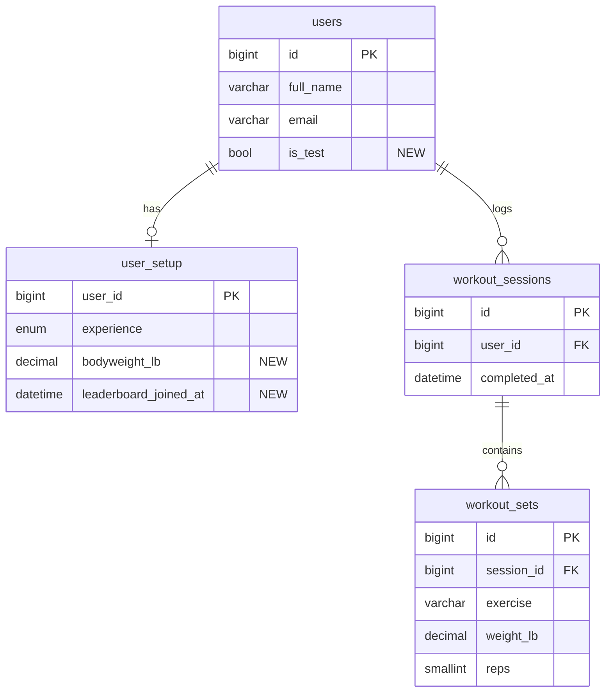

# Story #10 leaderboard: research

- **Story:** #10, "As a competitive gym goer, I want to view my rank and compare my performance against others…"
- **Status:** planning only, for PM review before implementation starts. Nothing here is built.
- **Who writes what:** one file for both research tasks under story #10.
  - Sam (research task #113, branch `113-leaderboard-participation-research`) writes "Participation and viewing the
    rankings".
  - Mansur writes "Ranking rules and data" on his own branch, after #113 is merged into dev.
  - Both write the "Coordinated recommendation" together.
- **Sketches:** [Figma page "Leaderboard plan (story #10)"](https://www.figma.com/design/JMSaaXvmkMfjxrQuQqQ7CV/GymRank?node-id=1917-55)

## Participation and viewing the rankings (Sam, #113)

This part covers who takes part, how people view the rankings and how they find their own position. The numbers follow
Mansur's proposed ranking plan: the score is your best estimated 1RM ÷ your bodyweight; your tier is the highest one you
reach on bench press, back squat or deadlift; and the tier cutoffs are placeholders. If his worked examples change, the
numbers here change with them.

### Who takes part

| | A. Opt-in public tier boards (recommended) | B. Friends only |
| --- | --- | --- |
| Who appears | People who pressed **Join the leaderboard**, added a bodyweight and finished 3 workouts. You only appear on your own tier's boards. | You plus people who accepted your invite, across all tiers. |
| How you join and leave | A Join button on the Leaderboard page. You leave with a **Show me on the leaderboard** switch on Profile. | Invite people by link and they accept. You leave by removing a friend. |
| Ineligible state | A "Four steps to get ranked" checklist (frames D4/P4, D5/P5). | The same checklist, plus "1 friend isn't ranked yet" under the list. |
| Empty state | A tier with nobody in it (D6/P6), or a new site where nobody is ranked yet. | The normal state for every new account: "Compare with friends" and **Copy invite link** (D10/P10). |
| Finding yourself | Needed: the top 10, a `· · ·` gap, then you with one person above and below. Your row is pinned to the bottom of a phone screen while you scroll. | Easy: the list is short. |
| Test accounts | They never press Join, and the backend hides them as well. The seeded demo people stay visible for acceptance tests. | They never appear unless someone invites them. |
| New data | A joined flag, bodyweight, and a test-account flag. | Friendships and invites (the same system story #78 needs). |
| Size of the work | 1 backend task and 1 frontend task, plus a Profile card. | About 2 backend and 2 frontend tasks, overlapping story #78. |
| What similar apps do | Tonal ("Join the leaderboard" and a privacy toggle), adidas Running ("Join running leaderboard" toggle). | Hevy (one board per exercise, Following only), Strava (Overall and Following tabs). |

**Recommendation:** build option A now. That means opt-in tier boards over all time, with an explicit Join and a way to
leave from Profile. Keep Friends as a disabled choice next to Everyone, and build option B later with story #78's invite
system. The reasons:

- Option A is what story #10 describes: your position and everyone's scores.
- The fitness apps we looked at all make joining an explicit choice that you can undo.
- Option B on its own leaves every new account with an empty board.
- It reuses the rest of the page, so Friends can be added later without a redesign.

### How someone becomes eligible, views the rankings and finds their position

1. **Leaderboard** in the top navigation opens the page. Until you qualify you're "Unranked": your rank shows "—" and
   there are no tables. A "Four steps to get ranked" card lists, in order:
   1. **Join the leaderboard.** It says others will see "Casey M.", your tier and your best lifts, never your
      bodyweight.
   2. **Add your bodyweight.** It's private and used only for the ratio.
   3. **Finish 3 workouts** ("0 of 3 workouts logged").
   4. **Log a bench press, back squat or deadlift.**

   Frames D4/P4 show this card. Frames D5/P5 show "One more workout to get ranked".
2. Once you're ranked, the page opens on your own tier, Everyone, Overall (D1/P1). A ladder of five tier badges (Bronze
   to Diamond) shows your tier filled and marked "You", and the tiers above it locked. Under it are the tier's name, its
   people count, and a one-line rule ("Next is Platinum: a 225 lb bench press, 315 lb back squat or 360 lb deadlift at
   your bodyweight").
3. You view other rankings with three controls: the tier badges, an **Everyone | Friends** switch (Friends is marked
   "Later"), and the tabs **Overall**, **Bench press**, **Back squat** and **Deadlift**. Rows show the rank, first name
   and last initial, the lift, the ratio to bodyweight and the estimated 1RM in lb. Ties share a rank (4, 4, 6). Opening
   a tier you're not in shows "You're in Gold, so you're not on this board" (D3/P3).
4. You find your position in three places:
   - The "Your standing" card shows your tier, your rank on the current board ("#24 of 38") and your three lifts, each
     with its ratio, its lb and how many lb you need for the next tier.
   - In the table, your row is highlighted and marked "You". The board shows the top 10, `· · ·`, then you ±1 (D1, D2).
   - On a phone, your row stays pinned to the bottom of the screen while the top 10 is in view (P1b).
5. A "What you need for each tier" table turns the cutoffs into lb at your bodyweight, with ticks on the tiers you've
   reached.
6. You leave from Profile: a new "Leaderboard" card has a **Show me on the leaderboard** switch and your bodyweight
   (D11/P11). **Leaderboard settings** on your card links there.

| Ranked, desktop (D1) | Unranked, desktop (D4) |
| --- | --- |
|  |  |

| Your row pinned on a phone (P1b) | Leaving from Profile on a phone (P11) |
| --- | --- |
|  |  |

### Sketches

All frames are on the Figma page linked above, at 1440 wide (desktop) and 375 wide (phone). Every frame also has a
light-mode copy ("— light"), and every colour comes from the app's `--gr-` colour tokens in `src/index.css`.

- D1/P1: ranked, Gold, Overall, with you outside the top 10 and a tie at 4
- P1b: phone scrolled to the top 10, with your row pinned to the bottom
- D2/P2: ranked, Gold, Bench press board (Mansur's example: #14, 1.12×, 225 lb to Platinum)
- D3/P3: viewing another tier (Platinum), where you're not on the board
- D4/P4: unranked: not joined, no bodyweight, 0 of 3 workouts
- D5/P5: unranked: joined, bodyweight saved, 2 of 3 workouts
- D6/P6: empty tier (Diamond)
- D7/P7: loading
- D8/P8: couldn't load, with Try again
- D9/P9: option B (later phase): Friends board, for comparison
- D10/P10: option B (later phase): Friends with nobody yet
- D11/P11: Profile card with "Show me on the leaderboard" and bodyweight

### Proposed acceptance tests

These are proposals for the PM to review, not story #10's card yet. Once they're approved, they move into
`stories/10-leaderboard.md` and onto the card. They use proposed seed accounts, which the backend task would load. None
of them is an existing seed user, so stories 8, 9 and 18 keep their numbers. Boards show people as first name + last
initial.

- `Casey Morgan`, email `casey.morgan@example.com`: has joined, bodyweight 180 lb, more than 3 finished workouts. Best
  estimated 1RMs: bench press 202 lb, back squat 284 lb, deadlift 330 lb. Gold on all three lifts, #24 of 38 on Gold's
  Overall board and #14 on its Bench press board.
- 37 other Gold members (Derek K., Andre S. … Hannah B., as in the sketches), 7 Platinum members and nobody in Diamond.
  Jordan B. and Chris O. tie at 1.96× on Overall.
- `Luis Ortega`, email `luis.ortega@example.com`: a Gold member (#23, Deadlift 1.84×), used to look at the board as
  someone else.
- `Robin Hale`, email `robin.hale@example.com`: has joined, bodyweight saved, a bench press logged, 2 finished workouts.
- `Max Tester`, email `max.tester@example.com`: marked as a test account. Has joined, bodyweight 180 lb, 10 finished
  workouts, a 600 lb deadlift.

#### Acceptance Test 1: A new account is Unranked and sees how to get on the leaderboard

**Setup:** Connect to the UB VPN or use the campus network. Open the
[Login page](https://cattle.cse.buffalo.edu/CSE442/2026-Fall/cse-442y/#/login). Create a new account (for example
`Lead Tester`, `lead-a-1022@example.com`, `AcceptLead12!`), log in, and finish setup until the Dashboard opens.

1. Select **Leaderboard** in the top navigation. Confirm that the address ends in `#/leaderboard`, that **Leaderboard**
   is highlighted, and that the heading says `Leaderboard`.
2. Confirm that your card shows your name, the label `Unranked` and Rank `—`.
3. Confirm that a card titled `Four steps to get ranked` lists, in this order: `Join the leaderboard` (with a
   **Join the leaderboard** button), `Add your bodyweight`, `Finish 3 workouts` with `0 of 3 workouts logged`, and
   `Log a bench press, back squat or deadlift`.
4. Confirm that the page shows no tier badges, no Everyone/Friends switch, no lift tabs and no table of people.

#### Acceptance Test 2: Joining and saving your bodyweight complete the first two steps, and your bodyweight stays private

**Setup:** Log in as the account from Acceptance Test 1 and select **Leaderboard**.

1. Confirm that step 1 says what others will see: your first name and last initial, your tier and your best lifts, and
   never your bodyweight. Select **Join the leaderboard**. Confirm that step 1 now has a tick.
2. Type `0` in **Bodyweight (lb)** and select **Save bodyweight**. Confirm that a message next to the field says what's
   wrong and how to fix it (for example `Enter your bodyweight in pounds, from 50 to 700.`), and that step 2 isn't ticked.
3. Type `180` and select **Save bodyweight**. Confirm that step 2 now has a tick and says `180 lb`.
4. Log out, log back in and select **Leaderboard**. Confirm that steps 1 and 2 are still ticked and step 2 still says
   `180 lb`.
5. Log in as `casey.morgan@example.com` and select **Leaderboard**. Confirm that no row on any board shows anyone's
   bodyweight, only names, ratios and estimated 1RMs.

#### Acceptance Test 3: A ranked person sees their tier, their three lifts and their own place on the board

**Setup:** Log in as `casey.morgan@example.com` and select **Leaderboard**.

1. Confirm that your card shows `Casey Morgan`, the tier `Gold`, `Bodyweight 180 lb` and `Rank in Gold · Overall`
   `#24 of 38`.
2. Confirm that the three lift boxes show `Bench press` `1.12×` `202 lb est. 1RM`, `Back squat` `1.58×`
   `284 lb est. 1RM` and `Deadlift` `1.83×` `330 lb est. 1RM`, with `23 lb to Platinum (225 lb)`,
   `31 lb to Platinum (315 lb)` and `30 lb to Platinum (360 lb)`.
3. Confirm that, among the five tier badges, **Gold** is selected and marked `You`, that Platinum and Diamond show a
   lock, and that the text under them says `Gold`, `38 people in Gold` and
   `Next is Platinum: a 225 lb bench press, 315 lb back squat or 360 lb deadlift at your bodyweight.`
4. Confirm that **Everyone** and **Overall** are selected.
5. Confirm that the table lists ranks 1 to 10, starting with `Derek K.` `Deadlift` `1.99×` `418 lb`, then a `· · ·`
   gap, then ranks 23, 24 and 25: `Luis O.` `1.84×`, `Casey M.` `1.83×` and `Hannah B.` `1.81×`.
6. Confirm that Casey's row is highlighted and marked `You`, and that no other row is.

#### Acceptance Test 4: People with the same score share a rank and the next rank is skipped

**Setup:** Log in as Casey as in Acceptance Test 3 and select **Leaderboard**.

1. On the Overall board, confirm that `Jordan B.` and `Chris O.` both show rank `4` and `1.96×`, and that the next row
   is rank `6` (`Elena P.`, `1.95×`). No row has rank 5.
2. Select the **Bench press** tab. Confirm that `Chris O.` and `Sofia M.` both show rank `6` and `1.18×`, that the next
   row is rank `8`, and that Casey's card now says `Rank in Gold · Bench press` `#14 of 38`.

#### Acceptance Test 5: Switching tier and board shows the right people

**Setup:** Log in as Casey as in Acceptance Test 3 and select **Leaderboard**.

1. Select each of **Bench press**, **Back squat** and **Deadlift**. Confirm that each tab is shown as selected, that the
   rows are ordered from the highest ratio down, and that Casey's row is highlighted on each one.
2. Select the **Platinum** badge. Confirm that the text under the badges says `Platinum` and `7 people in Platinum`,
   that a note says `You're in Gold, so you're not on this board.`, that seven rows are listed starting with `Priya R.`
   `2.24×`, and that no row is marked `You`.
3. Select the **Diamond** badge. Confirm that the page says `No one is in Diamond yet` with the weights Diamond needs at
   180 lb (`270 lb` bench press, `360 lb` back squat, `450 lb` deadlift). Select **Back to your tier (Gold)**, and
   confirm that the Gold board returns.
4. Confirm that **Friends**, next to **Everyone**, is shown but can't be selected, and is marked `Later`.

#### Acceptance Test 6: The tier table shows what you need at your bodyweight

**Setup:** Log in as Casey as in Acceptance Test 3 and select **Leaderboard**.

1. Find the card `What you need for each tier`. Confirm that it says `At your bodyweight of 180 lb`.
2. Confirm that the rows show, for bench press, back squat and deadlift: `Bronze` 90, 135, 180 lb; `Silver` 135, 225,
   270 lb; `Gold` 180, 270, 315 lb; `Platinum` 225, 315, 360 lb; `Diamond` 270, 360, 450 lb.
3. Confirm that the Gold row is marked `You`, and that every Bronze, Silver and Gold weight has a tick while no Platinum
   or Diamond weight does.

#### Acceptance Test 7: People who shouldn't be ranked never appear

**Setup:** Log in as `robin.hale@example.com` and select **Leaderboard**.

1. Confirm that Robin's card says `Unranked` and `1 workout` left to get ranked; that `Join the leaderboard`,
   `Add your bodyweight` and `Log a bench press, back squat or deadlift` are ticked; and that `Finish 3 workouts` says
   `2 of 3 workouts logged`.
2. Log in as Casey and select **Leaderboard**. Select every tier badge and every tab in turn. Confirm that neither
   `Robin H.` nor `Max T.` appears on any of them, even though Max's 600 lb deadlift would top the Diamond board.

#### Acceptance Test 8: Leaving the leaderboard from Profile takes you off it straight away

**Setup:** Log in as Casey and select **Leaderboard**. Confirm that Casey is `#24 of 38` on Gold's Overall board.

1. Select **Leaderboard settings** on Casey's card. Confirm that the Profile page opens with a `Leaderboard` card
   showing **Show me on the leaderboard** switched on, and `Bodyweight` `180 lb`.
2. Turn **Show me on the leaderboard** off.
3. In another browser (or a private window), log in as `luis.ortega@example.com` (a Gold member) and select
   **Leaderboard**. Confirm that `Casey M.` isn't on Gold's Overall board, that the board says `37 people in Gold`, and
   that rank 24 is now `Hannah B.`.
4. As Casey, select **Leaderboard** again. Confirm that Casey is `Unranked`, and that step 1 offers
   **Join the leaderboard** again while the bodyweight and workout steps stay ticked.
5. Select **Join the leaderboard**. Confirm that Casey is back at `#24` on Gold's Overall board.

#### Acceptance Test 9: The leaderboard needs a login, works on a phone, and recovers from an error

**Setup:** Log out. Open Chrome DevTools (More tools > Developer tools) on the Leaderboard page.

1. Go to `#/leaderboard` while logged out. Confirm that you're sent to the Login page and no ranks are shown.
2. Log in as Casey. Turn on the device toolbar and pick a 375 × 812 phone size. Select **Leaderboard**. Confirm that
   everything fits without scrolling sideways, that all five tier badges fit on one line, and that each row shows the
   rank, the name, the lift and weight underneath, and the ratio.
3. Scroll so the top 10 is on screen. Confirm that Casey's row (`24`, `Casey M.`, `1.83×`) stays pinned to the bottom
   of the screen, and that it stops being pinned once Casey's own row in the list scrolls into view.
4. In DevTools, block requests to `leaderboard.php` (Network > right-click the request > Block request URL) and reload.
   Confirm that the page says `Couldn't load the leaderboard. Check your connection and try again.` with a
   **Try again** button, and shows no tiers, rows or `Unranked`.
5. Unblock the request and select **Try again**. Confirm that Casey's numbers from Acceptance Test 3 appear.
6. Switch to light mode (account menu > **Profile** > Appearance) and back. Confirm that every label, number and
   highlighted row is readable in both.

### Open questions

Each question shows the assumption the sketches make, and who decides it.

1. **Is joining separate from saving a bodyweight?** Assumption: yes. A joined flag is set by **Join the leaderboard**
   and cleared by the Profile switch. A saved bodyweight alone doesn't make anyone public. *(Mansur)*
2. **Where is bodyweight stored and edited?** No table has it yet. Assumption: it's entered on the Leaderboard page and
   editable from Profile, 50–700 lb, private, and today's bodyweight is used for every ratio. *(Mansur)*
3. **How are test accounts hidden?** Assumption: a flag on the account. Acceptance tests need visible seeded people, so
   the demo seed must not be flagged. *(Mansur)*
4. **The first example had Derek K. at 1.38× on bench press inside Gold, but 1.38× is Platinum on bench press.**
   Assumption: within a tier, every ratio stays below the next tier's cutoff (the Gold bench press board tops out at
   1.24×). *(Mansur)*
5. **Overall uses each person's best raw ratio, so deadlifts nearly always win** (Gold starts at 1.00× bench press,
   1.50× back squat and 1.75× deadlift). Assumption: the sketches show raw ratios. Suggestion: score each lift against
   its own cutoffs. *(Mansur)*
6. **Should strength be compared separately by sex and age?** Hevy and Tonal both do; our ratio doesn't. *(For PM)*
7. **Which exercises count?** Assumption: only `Bench press`, `Back squat` and `Deadlift`, not variations such as
   Goblet squat or Romanian deadlift. *(Mansur)*
8. **What tier is someone with no big-3 lift, or below Bronze on all three?** Assumption: step 4 of the checklist asks
   them to log one. Bronze is the floor once any of the three is logged. *(Mansur)*
9. **Does a lift board include people who never logged that lift?** Assumption: no, they're left off that board.
   *(Mansur)*
10. **In what order are tied people shown?** Assumption: name A to Z, so tests are stable. *(Mansur)*
11. **Are names shown in full?** Assumption: first name and last initial ("Derek K."), shortened by the server, as
    Brilliant and Duolingo do. You still see your own full name on your card. *(For PM)*
12. **Which time period?** Agreed with Mansur: all time only. A best-lift ratio barely changes week to week.

### References

These apps were studied on Mobbin for ideas only; no screens were copied. Liftoff isn't on Mobbin, so Hevy and Tonal
were the closest strength apps.

- Tonal: [Join the leaderboard card](https://mobbin.com/flows/eafb17b4-c283-4751-9ec4-7df483b31d85),
  [Participate on the leaderboard toggle](https://mobbin.com/screens/8ce4b7fb-1e87-4aa1-8843-80832068fa1f),
  [Strength Score](https://mobbin.com/screens/867b652a-c1f5-46c9-bd29-a8c0818e71d8)
- Hevy: [exercise leaderboard, Following](https://mobbin.com/screens/1d53dbfc-7c3b-4bef-9b79-49c3a21347c5),
  [Strength Level](https://mobbin.com/screens/14db3357-172d-401e-9179-05f032ec2a26),
  [0/3 setup card](https://mobbin.com/screens/d0cb0329-0306-4988-b898-9425238a8599)
- Strava: [Overall and Following tabs](https://mobbin.com/screens/03872167-8700-409a-bbfd-260845e4e2e1)
- WHOOP: [your row pinned while scrolling](https://mobbin.com/screens/95150fa0-40f2-4f3a-9e1b-19c7fa4072b8)
- adidas Running: [Join running leaderboard toggle](https://mobbin.com/screens/bf60b8e6-de4b-4051-9d4a-0d0154a92eae)
- Brilliant: [Leagues, with ties 1, 1, 3](https://mobbin.com/flows/ddc4e69a-701d-4258-8277-d94db0784930)
- Duolingo: [web leaderboard with league badges](https://mobbin.com/screens/c60e1207-648b-491d-8eb8-4b626fb22c17)
- Life Reset: [tier list with "You're here"](https://mobbin.com/screens/fab234c3-8ed3-47d7-b1c2-c23377829910)

## Ranking rules and data (Mansur)

This part covers how a person is scored and placed, who can be ranked, worked examples, the data it needs and the backend
tests to write. It was agreed with Sam: the score is **strength ratio**, tiers come from the best of bench press, back
squat and deadlift, and the board covers all time. The tier cutoffs are placeholders for the PM to review.

### Options compared

Three ways to score a person were compared. All three use the same rules for who appears (see "Recommended rule"), so
the comparison is only about the score.

| | A. Weekly volume | B. Strength ratio (recommended) | C. Points |
| --- | --- | --- | --- |
| Score | Sum of weight × reps over every set in the week (the volume #109 already computes). | Best estimated 1RM (Epley) ÷ bodyweight, per lift. | 10 per finished workout in the week, plus 20 per new PR (#109's definition). |
| Good | Easy to explain; needs no bodyweight; the data already exists. | Fair across body sizes; matches the tier requirements people see; a real strength measure that barely changes week to week. | Rewards showing up; works for bodyweight exercises too. |
| Weak | Rewards the heaviest and most active people, and one huge set tops the board. Favours big bodies. | Needs a bodyweight and one of the three lifts; bodyweight is self-reported. | The numbers (10 and 20) are arbitrary; many tiny workouts earn points. |
| Easy to game with test accounts? | Yes. One account logging a lot of volume sits at the top, and there is no ceiling. | Hard. The score is bound to a real lift at a bodyweight, and each tier is its own board. | Yes. Finishing several short workouts passes the 3-workout rule and farms points. |
| Similar apps | Strava-style totals. | Hevy (Strength Level) and Tonal (Strength Score) both rank strength against bodyweight. | Duolingo-style points leagues. |

**Recommendation:** option B. It ranks what the app is about (how strong you are for your size), it matches the
requirements table users will see, and it is the hardest to flood with fake accounts. From Hevy and Tonal we took the idea of
ranking strength against bodyweight. A and C stay as ideas for a later "this week" board.

### Worked examples

One week of data (Monday October 12 to Sunday October 18, 2026, New York days) for the same people, scored three ways.
Weights are in lb. Estimated 1RM = weight × (1 + reps ÷ 30).

| Person | Bodyweight | Finished workouts (all time) | This week's workout volumes | New PRs this week | Best sets (weight × reps = est. 1RM): bench / squat / deadlift |
| --- | --- | --- | --- | --- | --- |
| Ana Cole | 200 | 5 | 8,000 + 8,000 + 8,000 = 24,000 | 1 | 175×6 = 210 / 220×6 = 264 / 300×6 = 360 |
| Ben Ortiz | 200 | 4 | 12,000 + 7,000 + 5,000 = 24,000 | 0 | 175×6 = 210 / 260×6 = 312 / 250×6 = 300 |
| Cy Park | 200 | 3 | 10,000 + 8,500 = 18,500 | 2 | 150×6 = 180 / 270×6 = 324 / 240×6 = 288 |
| Dee Sharma | 200 | 6 | 3,000 × 4 = 12,000 | 0 | 160×9 = 208 / 200×6 = 240 / 280×6 = 336 |
| Eli Ford | 200 | 3 | 9,000 | 1 | 200×6 = 240 / none / none |
| Gus Hart | 200 | 2 | 15,000 | 1 | 200×6 = 240 / none / none |
| Hana Reyes | not entered | 3 | 20,000 | 0 | 200×6 = 240 / none / none |
| Ivy Chen (has not joined) | 200 | 3 | 12,000 | 0 | 150×6 = 180 / none / none |
| Zed Quinn | 200 | 0 | none | 0 | none |
| Max Tester (test account) | 180 | 10 | 20,000 × 3 = 60,000 | 3 | 250×6 = 300 / 300×6 = 360 / 600×3 = 660 |

Max Tester (`max.tester@example.com`) has a deadlift of 600 lb × 3 (est. 1RM 660). Everyone has joined except Ivy.

**Option A, weekly volume.** Ana's score is 8,000 + 8,000 + 8,000 = 24,000.

| Rank | Person | Weekly volume |
| --- | --- | --- |
| 1 | Ana Cole | 24,000 |
| 1 | Ben Ortiz | 24,000 |
| 3 | Cy Park | 18,500 |
| 4 | Dee Sharma | 12,000 |
| 5 | Eli Ford | 9,000 |

**Option C, points.** Ana's score is 3 workouts × 10 + 1 PR × 20 = 50.

| Rank | Person | Points |
| --- | --- | --- |
| 1 | Cy Park | 2 × 10 + 2 × 20 = 60 |
| 2 | Ana Cole | 50 |
| 3 | Dee Sharma | 4 × 10 = 40 |
| 4 | Ben Ortiz | 3 × 10 = 30 |
| 4 | Eli Ford | 1 × 10 + 1 × 20 = 30 |

**Option B, strength ratio (Gold, Overall board).** Ana's ratios are bench 210 ÷ 200 = 1.05, squat 264 ÷ 200 = 1.32 and
deadlift 360 ÷ 200 = 1.80. Her deadlift reaches the Gold cutoff (1.75) and the Platinum cutoff (2.00) is not reached, so she
is Gold. Her Overall score is the best of each ratio divided by that lift's Gold cutoff: 1.05 ÷ 1.00 = 1.05, 1.32 ÷ 1.50 =
0.88 and 1.80 ÷ 1.75 = 1.03, so 1.05.

| Person | Bench | Squat | Deadlift | Tier | Overall score (lift) |
| --- | --- | --- | --- | --- | --- |
| Ana Cole | 1.05 | 1.32 | 1.80 | Gold | 1.05 (bench) |
| Ben Ortiz | 1.05 | 1.56 | 1.50 | Gold | 1.05 (bench) |
| Cy Park | 0.90 | 1.62 | 1.44 | Gold | 1.08 (squat) |
| Dee Sharma | 1.04 | 1.20 | 1.68 | Gold | 1.04 (bench) |
| Eli Ford | 1.20 | none | none | Gold | 1.20 (bench) |

| Rank | Person | Overall score |
| --- | --- | --- |
| 1 | Eli Ford | 1.20 |
| 2 | Cy Park | 1.08 |
| 3 | Ana Cole | 1.05 |
| 3 | Ben Ortiz | 1.05 |
| 5 | Dee Sharma | 1.04 |

The Gold Bench press board is Eli 1.20, then Ana and Ben tied at 1.05 (rank 2), Dee 1.04 (rank 4), Cy 0.90 (rank 5).
Eli is not on the Squat or Deadlift boards, because he has never logged those lifts.

**What the examples show:**

- **Scores and order.** Ana is #1 (tied) by volume, #2 by points and #3 (tied) by strength ratio. Eli, who has done
  the least this week, is last by volume and #1 by ratio. The choice of score changes who is on top.
- **Ties.** People with the same score share a rank and the next rank is skipped (1, 1, 3 and 4, 4). People tied on a
  score are listed by full name A to Z, then by user id, so the order is the same every time. Names on screen are
  shortened ("Ana C."), so two people can look alike, which is why the sort uses the full name.
- **People with no finished workouts or too few.** Zed (0 finished workouts) and Gus (2) are unranked under all three
  options. They are on no table and see their progress toward 3 workouts instead.
- **Other reasons for being unranked.** Hana has no bodyweight and Ivy has not joined. Neither is on any table.
- **Test accounts.** Max Tester is in the table to show what he would score if he were not excluded: 60,000 lb of volume
  (#1 for volume), 3 × 10 + 3 × 20 = 90 points (#1 for points) and a ratio of 660 ÷ 180 = 3.67 (Diamond). He is on no
  board under any option, because he is marked as a test account.

### Recommended rule

**Who can be ranked.** All of these must be true, the same for every board:

1. The person pressed **Join the leaderboard** (joining is separate from saving a bodyweight).
2. They are not a test account (`users.is_test = 0`).
3. They have a bodyweight on file (50 to 700 lb, private, today's value is used for every ratio).
4. They have at least 3 finished workouts (`completed_at` is not NULL).
5. They have logged at least one counted set of the three lifts (see "What counts").

Anyone else is unranked. They are on no board and see the checklist in the participation section above.

**What counts.** Only exactly `Bench press`, `Back squat` and `Deadlift`. Variations such as Goblet squat or Romanian
deadlift do not count. Only sets in finished workouts count, and sets of more than 10 reps are ignored (Epley is
unreliable above that, and one long set would otherwise inflate the estimate). Sets of 0 lb are ignored, as in #109.

**The score.**

- **Lift ratio** = the lift's best estimated 1RM over all finished workouts ÷ bodyweight, rounded to 2 decimals (half up).
- **Tier** = the highest tier reached on any one lift. The cutoffs differ per lift, because people lift much more
  on deadlift than on bench press:

| Tier | Bench press | Back squat | Deadlift |
| --- | --- | --- | --- |
| Bronze | 0.50× | 0.75× | 1.00× |
| Silver | 0.75× | 1.25× | 1.50× |
| Gold | 1.00× | 1.50× | 1.75× |
| Platinum | 1.25× | 1.75× | 2.00× |
| Diamond | 1.50× | 2.00× | 2.50× |

- **Bronze is the floor.** Once someone has logged any of the three lifts they are at least Bronze, even if their ratio is
  below the Bronze cutoff. Someone with no big-3 lift is unranked.
- **Within a tier, every ratio stays below the next tier's cutoff.** A 1.38× bench press is Platinum, never Gold, so the
  Gold bench press board tops out at 1.24×.
- **Overall score** = for each lift, its ratio ÷ that lift's Gold cutoff, and the best of those, rounded to 2 decimals.
  Without this, deadlift ratios (always the largest) would decide every Overall board.
- **A lift board's score** is that lift's ratio. A person who never logged that lift is left off that board.

**The tables.** Each tier has four boards: Overall, Bench press, Back squat and Deadlift. A board lists every ranked
person in that tier, ordered by score, highest first. The board covers **all time**, so a week or month has no effect.

**Examples with the tier table.**

- At 200 lb, someone with a back squat of 260 lb (1.30×), a bench press of 110 lb (0.55×) and a deadlift of 220 lb
  (1.10×) is **Silver**: their squat reaches Silver (1.25×), and bench press and deadlift only reach Bronze.
- At 180 lb (Casey Morgan in the sketches), the table in pounds is:

| Tier | Bench press | Back squat | Deadlift |
| --- | --- | --- | --- |
| Bronze | 90 lb | 135 lb | 180 lb |
| Silver | 135 lb | 225 lb | 270 lb |
| Gold | 180 lb | 270 lb | 315 lb |
| Platinum | 225 lb | 315 lb | 360 lb |
| Diamond | 270 lb | 360 lb | 450 lb |

  Casey's bests are bench press 202 lb (1.12×), back squat 284 lb (1.58×) and deadlift 330 lb (1.83×). All three are Gold,
  and her Overall score is 1.12 (bench press ÷ 1.00). Platinum needs a bench press of 225 lb, a back squat of 315 lb or a
  deadlift of 360 lb, which is the "225 lb to Platinum" in the sketches.

**How test accounts stay off the board.** Four rules apply to every option, and together they decide who appears:

- **Join.** Test and demo accounts never press Join, apart from the seeded demo people the acceptance tests need.
- **3 finished workouts.** A fresh sign-up has none. Unfinished workouts never count.
- **A bodyweight.** Nobody is ranked without one.
- **A test-account flag.** `users.is_test` is set by a seed file or by hand in SQL, and never from the app, so no user
  can mark themselves or others. The flag is the only rule that fully excludes someone who has done all the rest,
  like Max Tester above.

The flag is a column rather than an email check because every fake account uses `@example.com`, including the seeded
demo people who must stay visible. The flag only catches accounts we mark. A real person who signs up with a throwaway
account and joins is a real participant, and the join, workout and bodyweight rules are the protection for that.

**Day rule.** A day is the America/New_York calendar date of `completed_at` and weeks run Monday to Sunday, as in #109.
The board covers all time, so this only affects the dates shown ("Joined October 20, 2026").

### Required data

No change to the workout tables. The estimated 1RMs come from `workout_sets` and `workout_sessions`, which #105 already
fills.

| Table | New column | Purpose |
| --- | --- | --- |
| `users` | `is_test` `TINYINT(1) NOT NULL DEFAULT 0` | Hides test accounts. Set only by seeds or SQL. |
| `user_setup` | `bodyweight_lb` `DECIMAL(4,1) NULL`, checked between 50 and 700 | The ratio's denominator. Private. |
| `user_setup` | `leaderboard_joined_at` `DATETIME NULL` (UTC) | Set by **Join the leaderboard**, cleared by the Profile switch. NULL means not on the board. |

**Migration.** `database/migrations/011_leaderboard.sql` adds the three columns. MySQL has no `ADD COLUMN IF NOT EXISTS`,
so, as `005` and `007` do, it checks `information_schema` first and can be run more than once. Its top comment says how
to apply it locally, on aptitude and on cattle. Existing rows need no backfill: every account starts with
`is_test = 0`, no bodyweight and not joined, which means nobody is on the board until they choose to join.

**Seed.** `database/seeds/leaderboard.sql` loads the people from the participation section (Casey Morgan, Luis Ortega,
Robin Hale and the Gold and Platinum members) with `is_test = 0`, and Max Tester with `is_test = 1`. None of the
existing seed users (Marcus, Dana, Riley, Taylor and the others) is changed, so stories 8, 9 and 18 keep their numbers.

**Not stored.** Tiers, ratios and ranks are worked out from the workout data on every request, so a new finished workout
moves someone the next time the page loads. The cutoff table is a constant in the PHP file. If the query ever gets
slow (roughly thousands of users), the upgrade is a small table filled when a workout is completed.

**API.** `GET api/leaderboard.php?tier=gold&board=overall` (`tier`: bronze to diamond, default your own tier;
`board`: overall, bench, squat or deadlift, default overall) returns:

- `tier`, `board`, `ranked_count` ("38 people in Gold") and `requirements`, the cutoff table above.
- `rows`: the top 10 plus you and one person either side, each `{rank, name, score, lift, is_me}`. Ranks are real, so a jump
  in rank is where the `· · ·` gap goes. `name` is already shortened to first name and last initial ("Derek K.") on the
  server, so full names never leave it. A row never has an email, user id, bodyweight or estimated 1RM, because ratio and
  1RM together would reveal someone's bodyweight.
- `me`: your own `tier`, `rank` (null when you are looking at a tier you are not in), `score`, `joined`, `bodyweight_lb`,
  `e1rm_lb`, `lifts` (bench, squat and deadlift, each with its ratio, lb and tier, or null) and `workouts`. When you are unranked it
  also has `workouts_done`, `has_bodyweight`, `has_lift` and a `reason`, so the checklist can tick each step.

`POST api/leaderboard.php` with `{"join": true}` and/or `{"bodyweight_lb": 180}` joins and saves a bodyweight (400 outside
50 to 700). `DELETE api/leaderboard.php` leaves the board and keeps the workouts and the bodyweight. Errors follow #109:
401 `{"error":"Please log in."}`, 405 with an `Allow` header, 400 with one entry per bad parameter, and 500
`{"error":"Database error"}`.

### Proposed backend tests

These use the example people above (Ana, Ben, Cy, Dee, Eli and the unranked people) loaded by a seed. Weights are lb.

1. **Login required.** `GET api/leaderboard.php` with no cookie returns 401 `{"error":"Please log in."}`. A made-up cookie
   gives the same. `PUT` returns 405 with `Allow: GET, POST, DELETE`.
2. **Bad parameters.** `?tier=gold2&board=biceps` returns 400 with `errors.tier` and `errors.board`. Extra parameters such as
   `user_id=999` are ignored and the result is the same as without them.
3. **Minimum of 3 workouts.** Gus Hart (2 finished workouts) is on no board, and his `me` shows `workouts_done: 2`. Adding a
   third finished workout puts him on the board. Zed Quinn (0 workouts) gets a normal unranked answer, not an error.
4. **Test accounts never appear.** Max Tester (`is_test = 1`, joined, bodyweight 180, a 600 lb deadlift) is on no board
   for any tier or board, and the Diamond board is `rows: []`. His own request returns 200 with `reason: "test_account"`.
5. **Join and bodyweight are required.** Ivy Chen (not joined) and Hana Reyes (no bodyweight) are on no board.
   `POST {"join": true}` for Ivy puts her on the Silver board, and `POST {"bodyweight_lb": 190}` for Hana puts her on the
   Platinum board (240 ÷ 190 = 1.26). `POST {"bodyweight_lb": 40}` returns 400 with `errors.bodyweight_lb`.
6. **Only counted sets count.** Ivy's 300 × 12 bench press set (more than 10 reps) and an unfinished workout with a 400 × 3
   bench press are ignored: her bench press stays 150 × 6 (est. 180, ratio 0.90, Silver). Finishing that workout moves her
   to Diamond (400 × 3 is est. 440, ratio 2.20), and un-finishing it moves her back to Silver.
7. **Tier is the highest lift.** A person at 200 lb with a back squat of 260 (1.30×), bench press 110 (0.55×) and deadlift 220
   (1.10×) is Silver.
8. **Within a tier, ratios stay below the next cutoff.** A person with a bench press ratio of 1.38 is Platinum, and the
   Gold bench press board never shows a ratio of 1.25 or more.
9. **Overall is normalized.** Ana's `me.score` on the Gold Overall board is 1.05 (bench), not her raw deadlift ratio of 1.80.
10. **Ties.** On the Gold Overall board Ana and Ben both have rank 3 and Dee has rank 5, with Ana listed before Ben.
11. **Lift boards.** On the Gold Squat and Deadlift boards Eli Ford is absent (no such lift). On the Bench press board he is
    rank 1 with 1.20. His `me.rank` on the Squat board is null.
12. **Bronze floor.** A person whose bench press ratio is 0.48 (below the Bronze cutoff) is Bronze, not unranked. A person with
    three finished workouts and no big-3 lift is unranked with `has_lift: false`.
13. **Privacy.** Every row has only `rank`, `name`, `score`, `lift` and `is_me`. Names are shortened ("Ana C."). No row has an
    email, id, bodyweight or `e1rm_lb`.
14. **Leaving.** `DELETE` takes the person off every board straight away and keeps their workouts and bodyweight. A second
    `POST {"join": true}` puts them back with the same score.
15. **Day rule.** A person who joined at 02:00 UTC on October 21 is shown as joined on October 20 (New York).

### Answers to the open questions marked (Mansur)

1. **Is joining separate from a bodyweight?** Yes. `leaderboard_joined_at` is set by Join and cleared by the Profile
   switch. A saved bodyweight alone never makes anyone public.
2. **Where is bodyweight stored and edited?** `user_setup.bodyweight_lb`, 50 to 700 lb, private. It is entered on the Leaderboard
   page and edited from Profile, through the same `POST api/leaderboard.php`. Today's value is used for every ratio.
3. **How are test accounts hidden?** `users.is_test`, set only by seeds or SQL. The demo seed leaves it at 0 and only
   Max Tester is 1.
4. **The Derek K. example.** Agreed: within a tier every ratio stays below the next tier's cutoff.
5. **Overall.** Each lift is scored against its own Gold cutoff (ratio ÷ cutoff). Frames D1/P1 show raw ratios up to 1.99×
   and change: for example Jordan B. and Chris O.'s 1.96× deadlift becomes 1.96 ÷ 1.75 = 1.12, and they still tie.
7. **Which exercises count?** Only exactly `Bench press`, `Back squat` and `Deadlift`.
8. **No big-3 lift, or below Bronze.** Below Bronze on every lift is Bronze once any of the three is logged. With no big-3 lift
   the person is unranked.
9. **A lift board for someone who never logged the lift.** They are left off it.
10. **Order of ties.** The same rank, then full name A to Z, then user id.

Questions 6 (sex and age) and 11 (names) stay with the PM. Recommended for 11: first name and last initial, shortened by
the server.

New questions from this section:

- **Should other people's rows show estimated 1RM in lb?** Recommendation: no. Ratio and 1RM together reveal someone's
  bodyweight, which the participation section promises is never shown. The frames show it on every row, so they would
  drop it from other people's rows and keep it on your own card. *(Sam, PM)*
- **Are sets of more than 10 reps ignored?** Assumption: yes, because Epley is unreliable above 10 reps. #109 has no such
  rule, so it applies to the leaderboard only. *(Sam, PM)*
- **Are the cutoffs right?** They are placeholders based on common strength standards and mostly describe male lifters
  (see question 6). *(PM)*
- **If someone's bodyweight goes up, can their tier go down?** Assumption: yes. The ratio always uses today's bodyweight.
  The alternative (never demote) needs a stored "highest tier reached". *(PM)*

## Coordinated recommendation

*Draft by Mansur. Sam confirms or edits before the PM meeting.*

Build **option A for participation (opt-in tier boards, all time)** with **strength ratio as the score**, in this order:

1. Migration `011_leaderboard.sql` and `database/seeds/leaderboard.sql` (backend, #114's follow-up card).
2. `GET api/leaderboard.php`: boards, tiers, `me` and the unranked checklist fields.
3. `POST` and `DELETE api/leaderboard.php`: join, leave and bodyweight.
4. The Leaderboard page, the "Four steps to get ranked" card, the tier ladder and the Profile card (frontend).
5. Later: the Friends board, with the invite system story #78 needs.

Changes this makes to the sketches: Overall shows normalized scores (D1/P1), and other people's rows drop the estimated
1RM in lb. The acceptance tests above use Sam's seed people, and the backend tests use the example people in this file;
the seed should include both sets so the two agree.
