# Story #131 / Task #133: how the navigation menu works, package for the redesign review

Sprint 4. Prepared 2026-11-13 for the redesign review. **Nothing is implemented.**

Story (the PM's wording, shared with Nicholas): *As a lifter, I want to choose a page from a menu grouped by activity, which is confirmed by seeing that page open with its section highlighted.*

Two tasks under it:

- **Nicholas's task: the menu map.** The labels, their order, their links and which section stays highlighted.
- **#133, Samuel: how the menu works** on every signed-in page (this package). Card title: *Build the navigation menu: desktop sidebar and phone menu*.

## 1. Where things stand

| Question from the brief | Answer |
| --- | --- |
| Is there a proposed card with tests? | Yes: card #133 holds the design details and **9 task tests** on aptitude, and a proposal for story #131's **6 acceptance tests** is in [`133-navigation-story-tests-proposal.md`](133-navigation-story-tests-proposal.md) for Nicholas, who leads the story, and Samuel to agree (section 7). |
| Is there an example to walk through? | Yes: [`133-navigation-menu-prototype.html`](133-navigation-menu-prototype.html), next to this file. Open it in a browser. It shows 12 screens at computer, tablet and phone width in dark and light mode, with a sample account and workout, and needs no server. The phone view is a real 375 px page, so the menu, Tab and Escape behave as they will in the app. |
| Is it built? | No. Programming starts after the review. |
| What is verified? | The example, with a script: 58 of 58 checks passed. They cover the sidebar staying in place over nine page changes, the highlighted section on nine pages, the Tab order, the two review checks (section 4), every menu row at least 44 px, no sideways scrolling at 1280, 1024, 901, 900, 768, 701, 700, 641, 375 and 320 px, the menu closing when the window is widened, logging out, and the card's three Console lines. |
| What is **not** verified yet? | Anything in the real app. The menu map is Nicholas's and this example uses the grouping from the assignment. "Resume workout" on Workouts and Dashboard is Surya's and Eric's (section 6). |

## 2. What the lifter sees

| # | Screen | Computer | Phone (375 px) |
| --- | --- | --- | --- |
| 01 | The sidebar on Dashboard, and the phone with the menu closed | 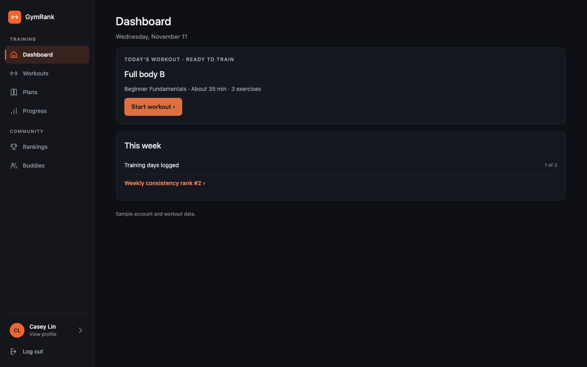 | 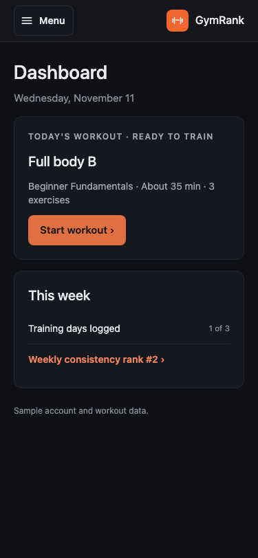 |
| 02 | Plan details keeps Plans highlighted; the phone menu open | 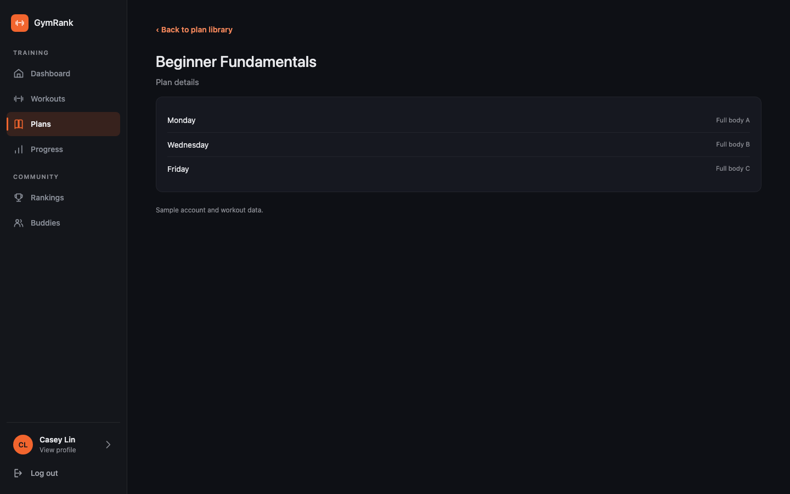 | 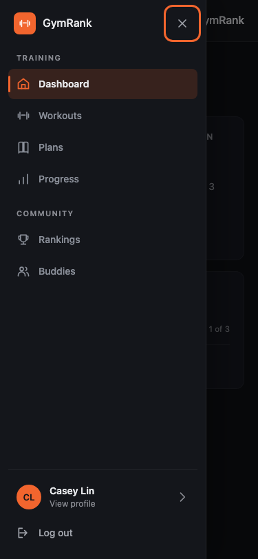 |
| 03 | Workout history keeps Progress highlighted | 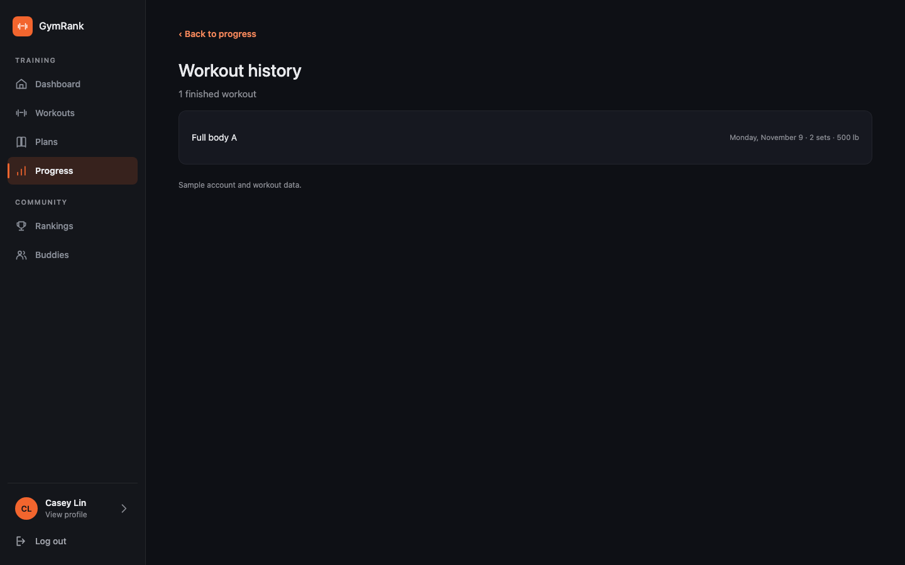 | |
| 04 | Logging a set: the menu is still there and Workouts is highlighted | 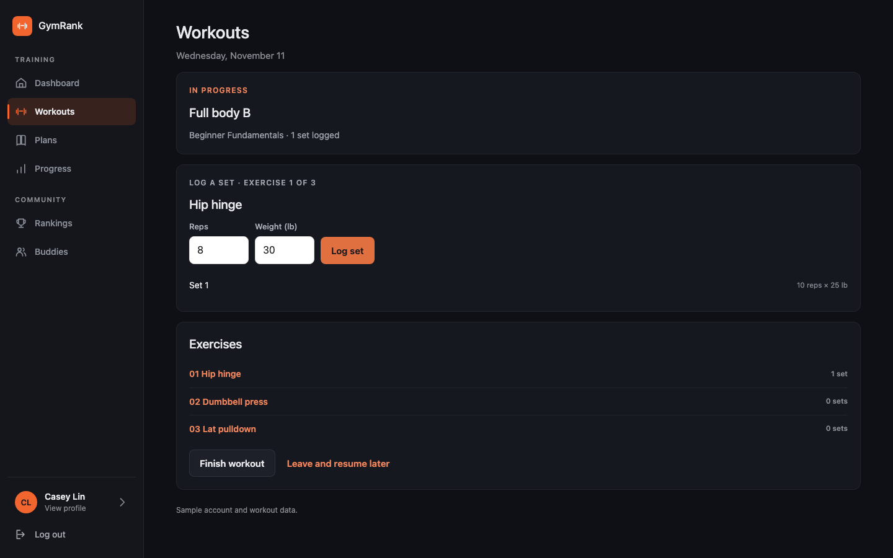 | 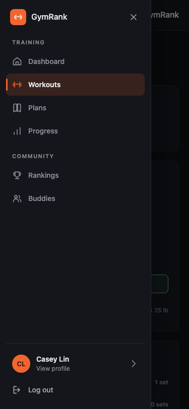 |
| 05 | Profile, reached from the bottom of the menu | 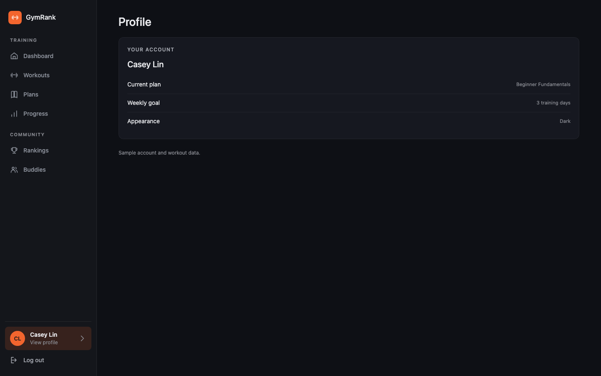 | |
| 06 | Tablet, 768 px: the sidebar is narrower (184 px) and the page has less padding | 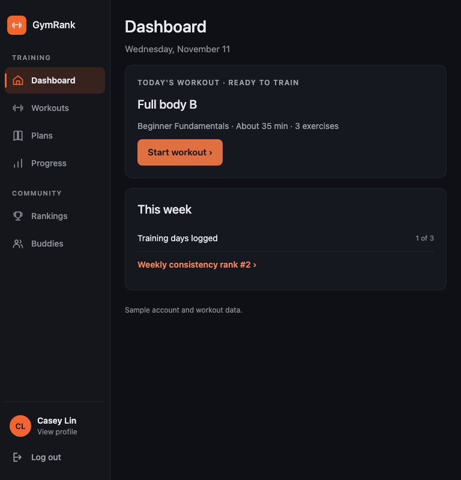 | |
| 07 | After "Log out": the login page, with no menu | 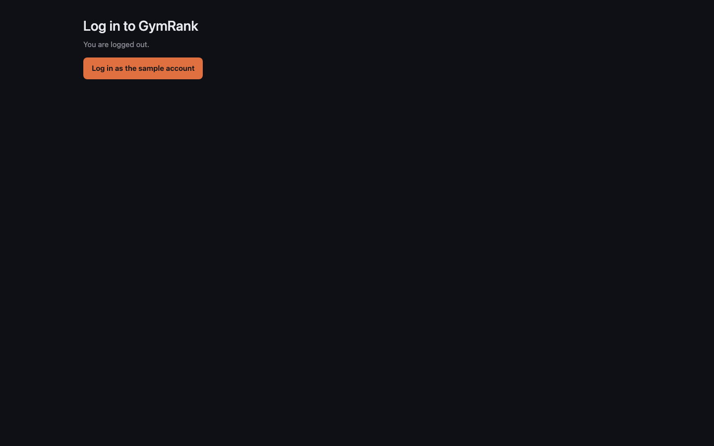 | |
| 08 | Light mode | 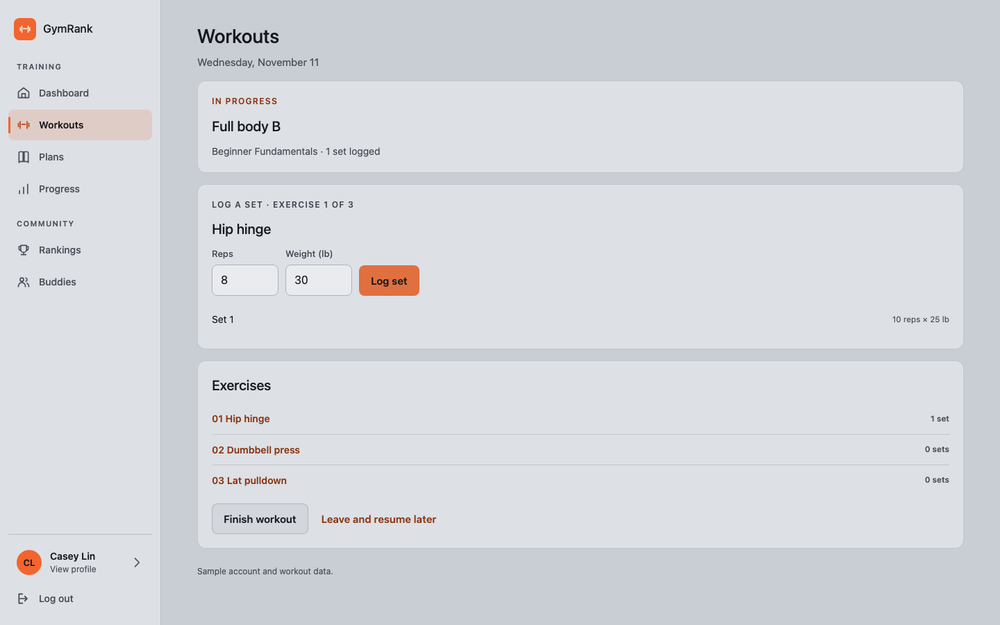 | 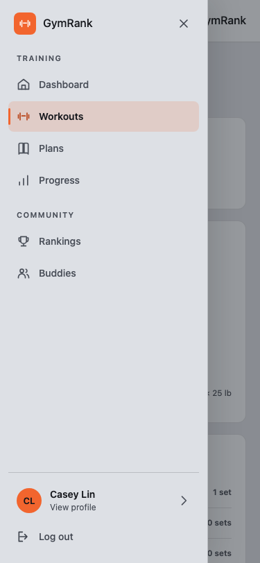 |

The example file itself:

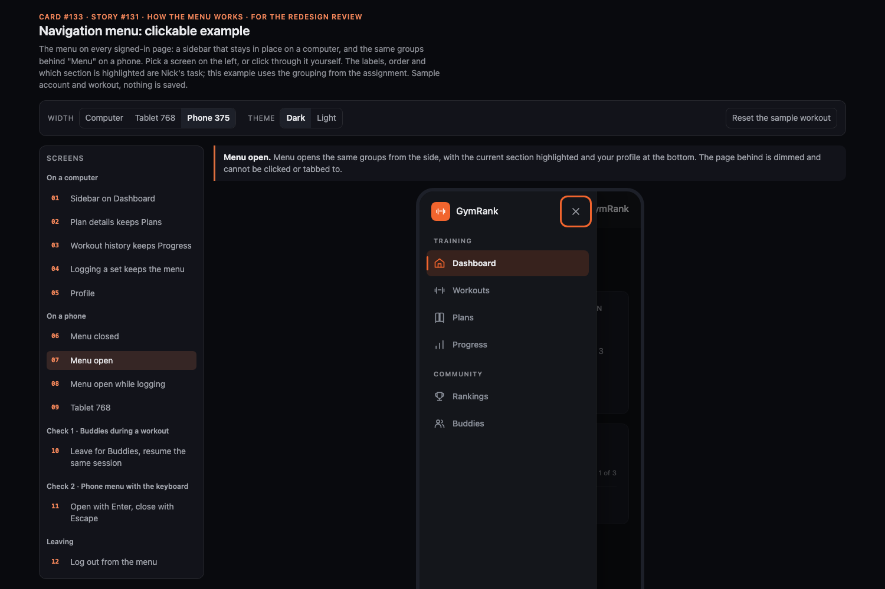

## 3. How the menu works

- **One menu, two layouts.** The same groups and rows are shown in the sidebar (701 px wide or more, as in the PM's mockup) and behind "Menu" (700 px or less): Training (Dashboard, Workouts, Plans, Progress), Community (Rankings, Buddies), then the profile row and "Log out".
- **The sidebar stays in place.** It is part of the frame around the signed-in pages, not part of each page, so changing pages changes only the page beside it.
- **"Menu" on a phone** opens the same groups from the left. The page behind is dimmed and cannot be clicked or tabbed to. Choosing a page, Escape, "Close" or a tap outside closes it.
- **Where you are** is always highlighted with an orange bar, a tinted row and bolder text, and is marked for screen readers. A page inside a section keeps the section highlighted.
- **Profile** is the bottom row in both layouts; **Log out** is directly under it.
- **Removed:** the top navigation bar, its "Start Workout" button, its round account button and the "Today" entry. Starting or resuming belongs beside the workout. The old address `#/workouts/today` keeps working.
- **Still no menu** on Login, Create account and the onboarding steps.

## 4. The two checks for the review

Both can be done in the example (screens 10 and 11 in its list) and are task tests 5 and 4 on the card.

**Check 1: open Buddies during a workout, choose Workouts from the menu and resume the same session.**

| Step | Result |
| --- | --- |
| On a phone, a workout is in progress: one set (10 reps × 25 lb) is saved, and 8 and 30 are typed but not logged. Press "Menu". | The menu opens over the workout; Workouts is highlighted.   |
| Choose Buddies. | The menu closes and Workout buddies opens.  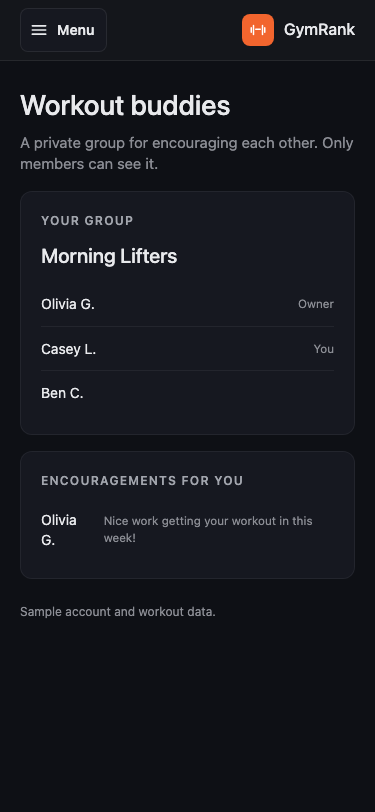 |
| Press "Menu" and choose Workouts. | Workouts shows "In progress", "1 set logged" and "Resume workout".  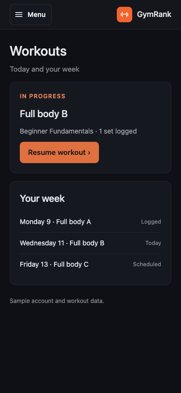 |
| Press "Resume workout". | The same session, on the same exercise, with Set 1 (10 reps × 25 lb) and 8 and 30 still typed.  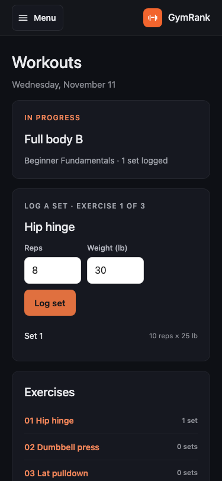 |

**Check 2: open the phone menu with a keyboard, press Escape and show that focus returns to Menu.**

| Step | Result |
| --- | --- |
| Press Tab until "Menu" is outlined, then Enter. | The menu opens; the outline is on its "Close" button. |
| Press Tab several times. | The outline moves through the rows of the menu and never reaches the page behind. |
| Press Escape. | The menu closes; the outline is back on "Menu". |
| Press Enter, Tab to Buddies, Enter. | The menu closes and Workout buddies opens with the focus on its title. |

## 5. Open points for the review

1. **Pages beside the sidebar on a tablet.** The sidebar shows from 701 px, the same width as the PM's mockup, and is 184 px wide up to 900 px (232 px above that). At 768 px that leaves the page 584 px, and at 701 px 517 px. The app's pages switch to their phone layout by the width of the window (640 px or less), so between 701 and about 870 px a page would keep its computer layout in a space narrower than 640 px. This task therefore has to make the pages choose their layout by the space they actually have. It touches the 640 px rules in every page's styles, which is the largest part of the work and overlaps Mansur's page-width task.
2. **Log out in the menu.** The PM's mockup shows only the profile row. Proposed: keep "Log out" under it, because story tests log out from the navigation on most stories.
3. **Story checks that name the old bar.** Logging out through "Open account menu" (`tests/e2e/helpers.js` and stories 8, 9, 18, 86, 97), the class `nav-bar__link--current` (stories 8, 9, 72), the bar's text in story 18, and the link name "Leaderboard" (stories 10, 124) if it becomes "Rankings". The names "Primary", "Mobile navigation" and "Open navigation menu" are kept so the other checks keep working. Proposed: update these checks in this task.
4. **Story cards that describe the old bar** ("the row of links across the top", the round initials button), for example #78, need the new wording after this ships.

## 6. What this task needs from the other redesign tasks

| From | What | Why |
| --- | --- | --- |
| Nicholas | The menu map: labels, order, links and the section for every page (plan details → Plans, starting a workout → Workouts, workout history → Progress) | The menu is built from it in both layouts |
| Surya | "Resume workout" on Workouts and Dashboard for the same saved session, on any day | Check 1 chooses Workouts and resumes. Today the button shows only on the plan's training days |
| Eric | What stays on the workout screen when you come back (the exercise you were on, what you were typing) | Today the saved sets always come back; typed reps and weight come back on only one of the two logging screens. This task only makes sure the menu never ends or changes the session |
| Mansur | The shared page column from #130 | It has to sit in the space beside the sidebar |

## 7. Proposed acceptance tests for the story

The full text is in [`133-navigation-story-tests-proposal.md`](133-navigation-story-tests-proposal.md). It is a proposal: the story's file in `stories/` and the text on card #131 are Nicholas's to write. In short:

1. Choose a page from the menu on a computer
2. A page inside a section keeps its section highlighted
3. Choose a page from the menu on a phone
4. Use the phone menu with a keyboard
5. Visit Buddies during a workout and come back to the same workout
6. Profile and Log out are easy to reach, and pages before login have no menu
